# Wallet Transfer Service — Design Document

---

## Part 1: High-Level Design (HLD)

### 1.1 System Overview

A monolithic REST service enabling atomic wallet-to-wallet money transfers with idempotency guarantees, double-entry ledger accounting, and pessimistic concurrency control.

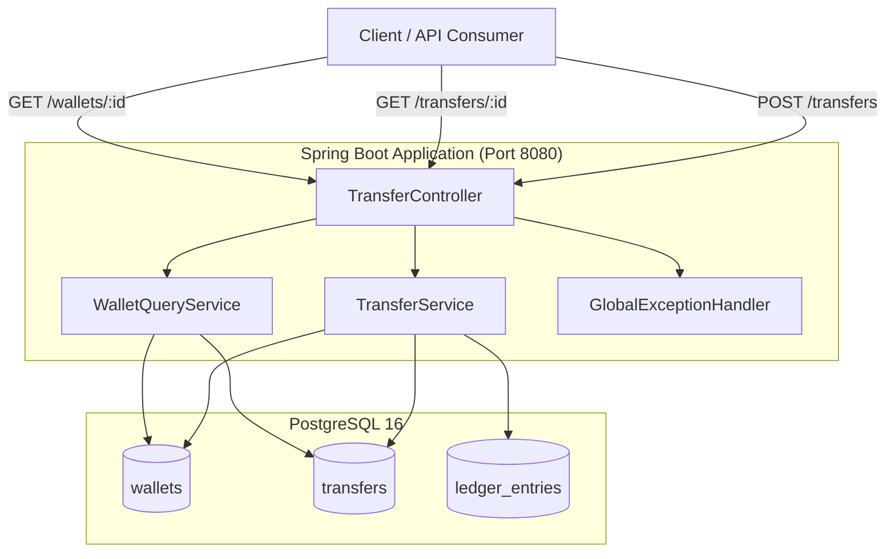

### 1.2 Technology Stack

| Layer | Technology | Rationale |
|-------|-----------|-----------|
| Runtime | Java 21 | Modern LTS, pattern matching, records |
| Framework | Spring Boot 3.3.5 | Industry standard, mature ecosystem |
| ORM | Hibernate / JPA | Entity mapping, pessimistic lock support |
| Database | PostgreSQL 16 | ACID, CHECK constraints, advisory locks |
| Migrations | Flyway | Versioned schema evolution |
| Testing | Testcontainers + JUnit 5 | Real PostgreSQL in tests, no mocks |
| Build | Maven | Standard Java build |
| Containerization | Docker Compose | Local development PostgreSQL |

### 1.3 API Design

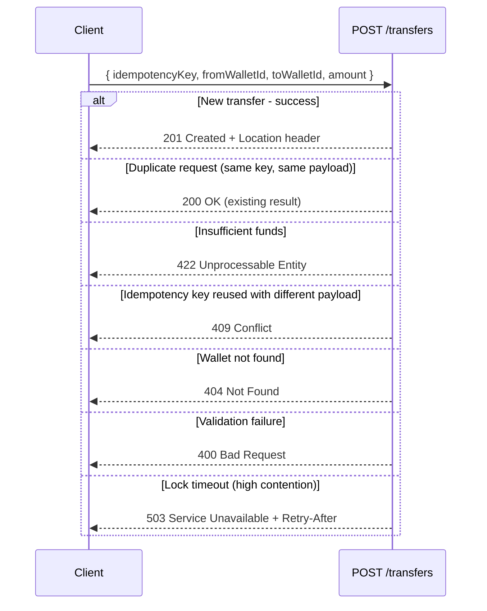

### 1.4 Key Design Decisions

| Decision | Choice | Alternative Considered |
|----------|--------|----------------------|
| Locking strategy | Pessimistic (`SELECT FOR UPDATE`) | Optimistic (`@Version` + retry) — rejected due to high retry cost under contention |
| Transaction control | Explicit `TransactionTemplate` | Declarative `@Transactional` — rejected because race recovery requires catching exceptions outside TX |
| Money representation | `BIGINT` (minor units) | `BigDecimal` / `NUMERIC` — BIGINT is simpler, faster, and sufficient for integer-unit currencies |
| Idempotency scope | Per-key, permanent (even for FAILED) | TTL-based expiry — simpler, prevents accidental re-execution |
| Architecture style | Monolith | Microservices — unnecessary for single-domain service |
| Seed data | Flyway repeatable migrations (`R__`) | Versioned `V100` — repeatable avoids version collision risk |

### 1.5 Non-Functional Characteristics

| Aspect | Design |
|--------|--------|
| Consistency | Strong — single PostgreSQL with SERIALIZABLE-equivalent via row locks |
| Availability | Single-instance; lock timeout returns 503 with Retry-After for graceful degradation |
| Durability | PostgreSQL WAL + fsync defaults |
| Auditability | Immutable double-entry ledger; failed transfers record balance snapshot |
| Testability | Testcontainers for real DB; no mocking of persistence layer |

---

## Part 2: Low-Level Design (LLD)

### 2.1 Package Structure

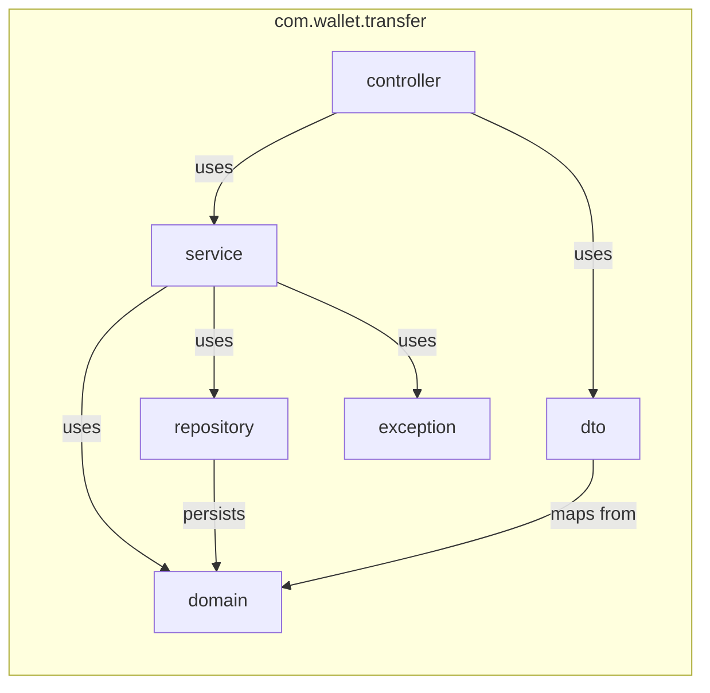

| Package | Responsibility |
|---------|---------------|
| `controller` | HTTP layer — request validation, response mapping, status codes |
| `service` | Business logic — transfer orchestration, idempotency, locking |
| `domain` | JPA entities with domain behavior (debit/credit/state transitions) |
| `dto` | Request/response records with Bean Validation annotations |
| `repository` | Spring Data JPA interfaces with custom lock queries |
| `exception` | Domain exceptions + centralized `@RestControllerAdvice` mapping |

### 2.2 Entity-Relationship Diagram

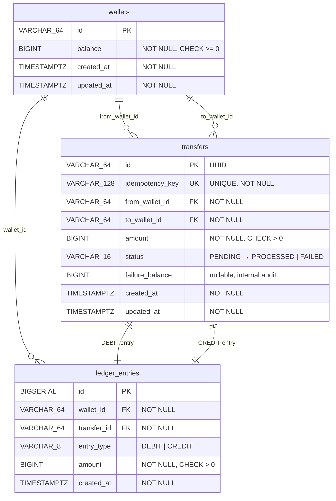

### 2.3 Transfer State Machine

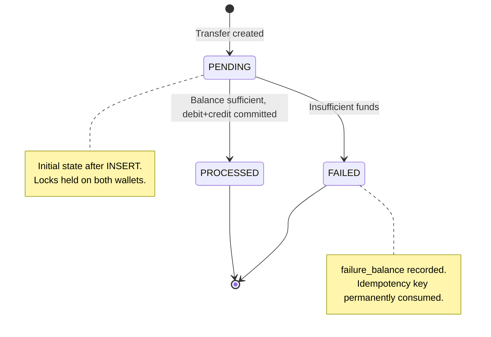

### 2.4 Core Transfer Flow (Detailed)

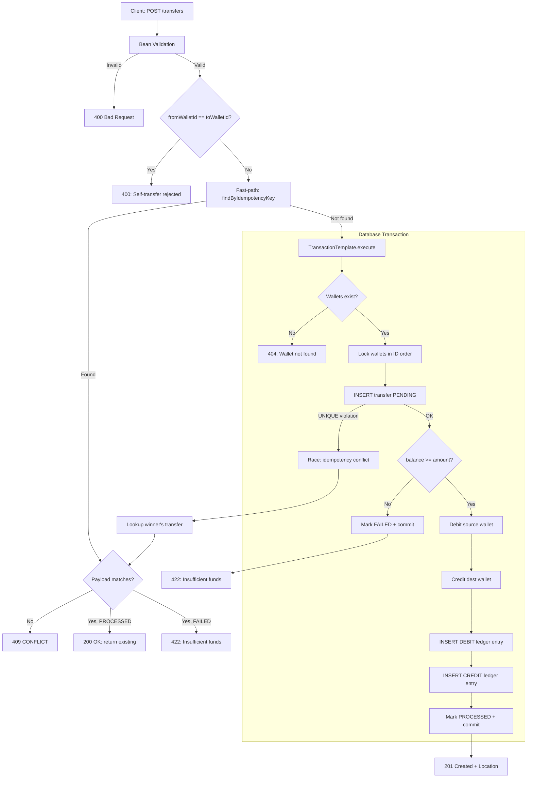

### 2.5 Concurrency Control — Detailed Sequence

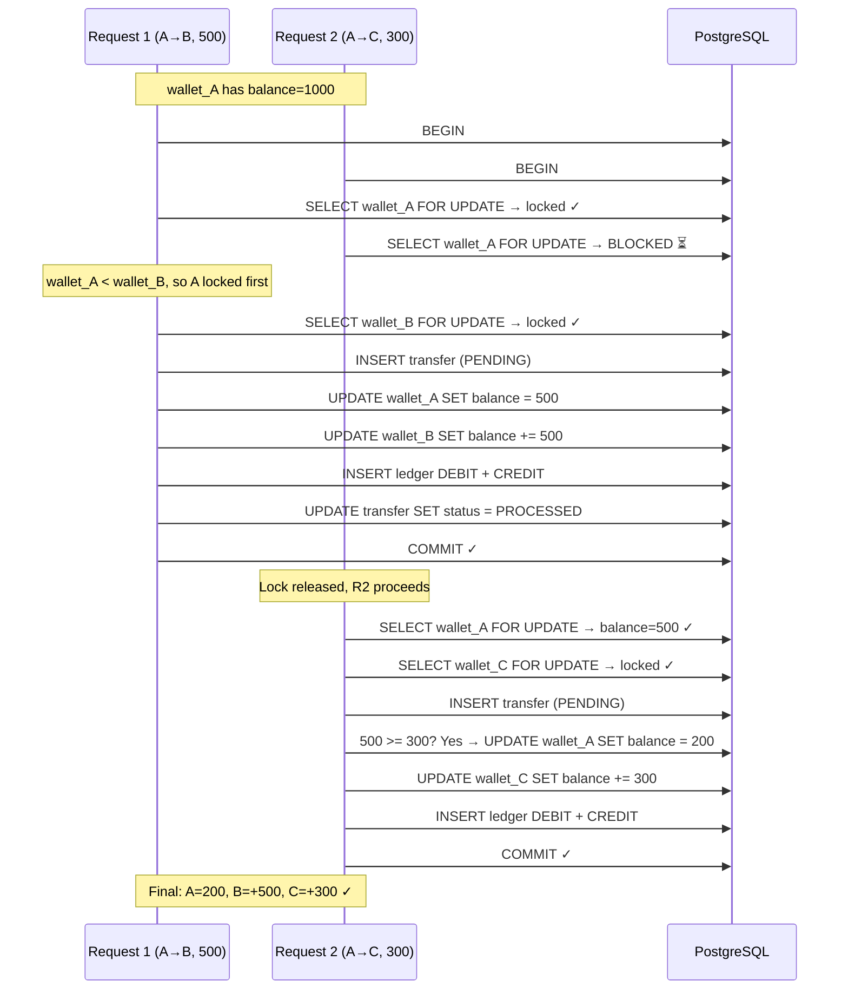

### 2.6 Idempotency Race Resolution

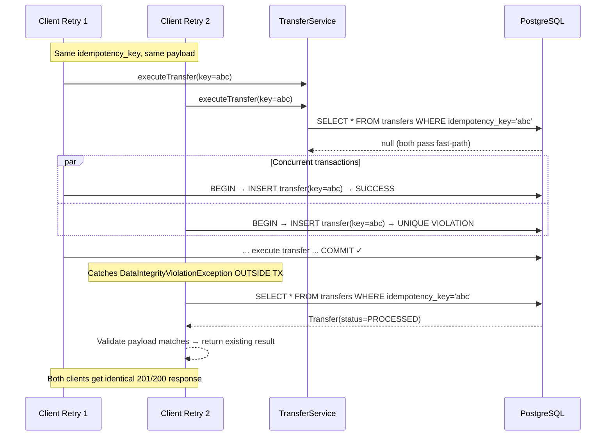

### 2.7 Class Responsibilities

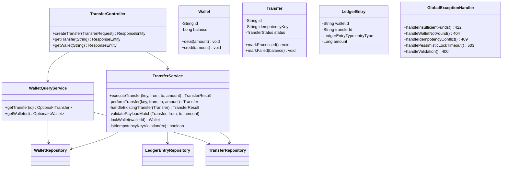

### 2.8 Error Handling Matrix

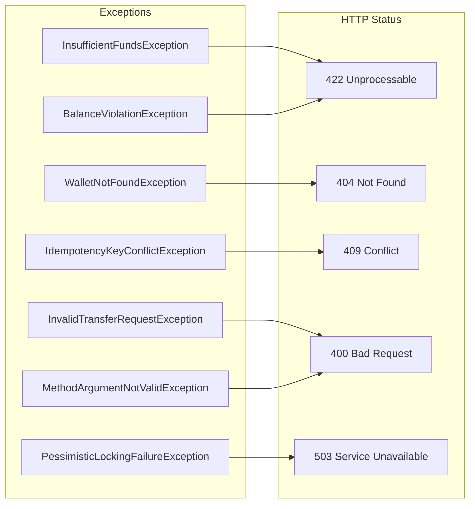

| Exception | HTTP | Error Code | When |
|-----------|------|-----------|------|
| `InsufficientFundsException` | 422 | `INSUFFICIENT_FUNDS` | Source wallet balance < amount |
| `WalletNotFoundException` | 404 | `WALLET_NOT_FOUND` | Wallet ID doesn't exist |
| `IdempotencyKeyConflictException` | 409 | `IDEMPOTENCY_KEY_CONFLICT` | Key reused with different payload |
| `InvalidTransferRequestException` | 400 | `BAD_REQUEST` | Self-transfer attempt |
| `BalanceViolationException` | 422 | `INSUFFICIENT_FUNDS` | Domain guard (defense-in-depth) |
| `PessimisticLockingFailureException` | 503 | `LOCK_TIMEOUT` | Lock wait exceeded 5s |
| `MethodArgumentNotValidException` | 400 | `VALIDATION_ERROR` | Bean Validation failure |

### 2.9 Request/Response DTOs

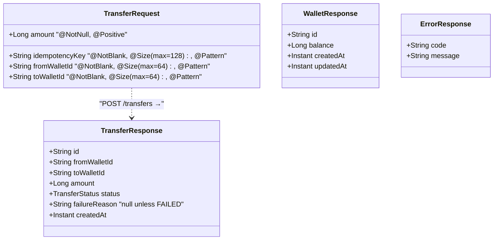

### 2.10 Database Indexes & Performance

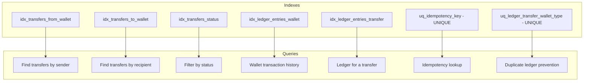

### 2.11 Deployment Architecture

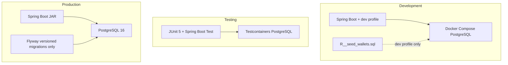

---

## Summary

| Aspect | HLD | LLD |
|--------|-----|-----|
| Architecture | Monolithic Spring Boot + PostgreSQL | Package-per-layer with rich domain entities |
| Concurrency | Pessimistic row locks, deterministic ordering | `SELECT FOR UPDATE` via JPA, 5s timeout, ID-ordered acquisition |
| Idempotency | Client-supplied key, UNIQUE constraint | Fast-path read → TX insert → race recovery outside TX |
| Accounting | Double-entry ledger | DEBIT+CREDIT pair per transfer, UNIQUE constraint prevents duplicates |
| Error handling | Typed exceptions → HTTP status codes | `@RestControllerAdvice` with granular exception mappers |
| Testing | Real database, no mocks | Testcontainers PostgreSQL, concurrent test harness |
