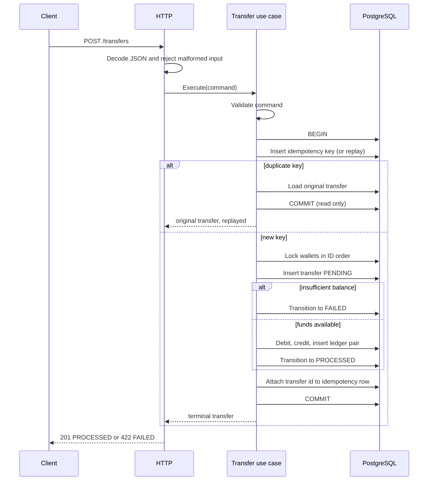

# Architecture

Wallet Transfer Service is a small HTTP API for creating wallets and moving integer amounts between them. A transfer is atomic: balances, the double-entry ledger, the transfer state, and the idempotency record commit together or not at all.

## Style

The code follows ports and adapters (hexagonal architecture). Dependencies point inward.

```text
HTTP adapter  ─┐
               ├─► application use cases ─► domain
Postgres adapter ┘            │
                              ▼
                         port interfaces
```

The domain and application packages do not import `pgx`, `net/http`, or the configuration loader.

## Package responsibilities

| Package | Responsibility |
| --- | --- |
| `internal/domain` | Wallet, transfer, and ledger types. Validation. Transfer state transitions. Sentinel and typed errors. |
| `internal/app/port` | Repository, unit-of-work, clock, and ID interfaces. |
| `internal/app/wallet` | Create and read wallets. |
| `internal/app/transfer` | Idempotent transfer workflow, ledger reads. |
| `internal/adapter/httpapi` | Routing, JSON, status codes, middleware. No business decisions. |
| `internal/adapter/postgres` | SQL, row locks, migrations, transaction boundaries. |
| `internal/platform/config` | `config.yaml` plus environment variables. |
| `internal/platform/logger` | Structured `slog` setup. |
| `internal/platform/requestid` | Request ID stored on `context.Context`. |
| `cmd/wallet-service` | Composition root: config, logging, database, HTTP server, shutdown. |

## Request flow



## Layer rules

- Handlers decode input, call one use case, and map the result to HTTP. They do not calculate balances or decide idempotency.
- Use cases decide the workflow: claim the key, lock wallets, transition state, write the ledger.
- Repositories run SQL. They do not decide whether a transfer should fail for insufficient funds; the conditional `UPDATE` reports that the debit predicate missed, and the use case interprets a pre-check under the row lock.
- Domain state transitions reject anything other than `PENDING -> PROCESSED` and `PENDING -> FAILED`.

## Composition

`cmd/wallet-service/main.go` is the only place that wires concrete adapters to use cases. Tests build the same use cases with an in-memory unit of work, or with the Postgres adapter against a real database.
