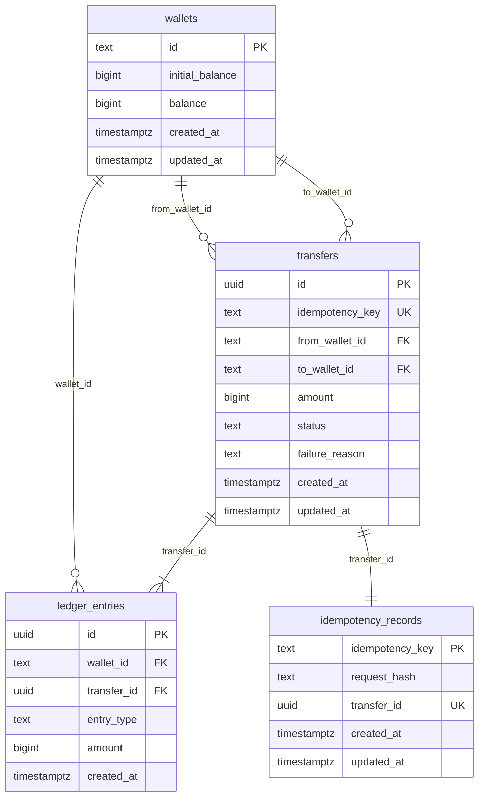

# Database

PostgreSQL is the system of record. The schema lives in `internal/adapter/postgres/migrations/00001_init.sql` and is applied with [goose](https://github.com/pressly/goose) on process startup.

## Tables



## Integrity rules enforced in the database

- Wallet balances and initial balances are `bigint` and `>= 0`. Amounts are never floating point.
- Transfer amount is `> 0`. Source and destination wallets must differ.
- `status` is `PENDING`, `PROCESSED`, or `FAILED`.
- A failed transfer must store `failure_reason`. Any other status must store `NULL`.
- `idempotency_key` is unique on `transfers` and is the primary key of `idempotency_records`.
- Ledger rows reference a transfer and a wallet. `UNIQUE (transfer_id, entry_type)` allows one debit and one credit.
- A deferred constraint trigger rejects a commit when:
  - a transfer is still `PENDING`
  - a `PROCESSED` transfer does not have exactly one debit and one credit for the transfer amount, on the source and destination wallets
  - a `FAILED` transfer has any ledger row
  - an idempotency row has a null `transfer_id`

Foreign keys use `ON DELETE RESTRICT`. Ledger rows cannot be inserted for a missing transfer.

## Indexes

| Index | Purpose |
| --- | --- |
| `transfers` primary key | Load a transfer by id |
| `transfers_idempotency_key_key` | Deduplicate transfers and look up retries |
| `transfers_from_wallet_created_idx` | History by source wallet |
| `transfers_to_wallet_created_idx` | History by destination wallet |
| `ledger_entries` primary key and `(transfer_id, entry_type)` unique | Fetch and constrain the pair |
| `ledger_entries_wallet_created_idx` | Wallet statement queries |
| `idempotency_records` primary key and unique `transfer_id` | Claim a key and join back to one transfer |

## Balances

The service stores the current balance on `wallets.balance` and updates it in the same transaction as the ledger. `initial_balance` is set once at wallet creation and is not a ledger event.

Reconciliation:

```sql
SELECT w.id,
       w.balance AS stored_balance,
       w.initial_balance
         + COALESCE(SUM(CASE WHEN e.entry_type = 'CREDIT' THEN e.amount ELSE -e.amount END), 0) AS ledger_balance
FROM wallets w
LEFT JOIN ledger_entries e ON e.wallet_id = w.id
GROUP BY w.id, w.balance, w.initial_balance
HAVING w.balance <> w.initial_balance
    + COALESCE(SUM(CASE WHEN e.entry_type = 'CREDIT' THEN e.amount ELSE -e.amount END), 0);
```

An empty result means every stored balance matches initial funding plus the ledger.

## Transactions and locks

Each transfer runs in one `READ COMMITTED` transaction:

1. Insert the idempotency row (`INSERT ... ON CONFLICT DO NOTHING`). A concurrent insert of the same key waits on the unique index.
2. If this transaction did not insert the row, load the committed transfer and return it.
3. Lock the two wallet rows with `SELECT ... FOR UPDATE`, always in ascending wallet id order.
4. Insert the transfer as `PENDING`, then either mark it `FAILED` or move funds, write the two ledger rows, and mark it `PROCESSED`.
5. Set `idempotency_records.transfer_id`.
6. Commit. Deferred triggers check the ledger and the idempotency row.

`lock_timeout` and `statement_timeout` are set locally on the transaction so a stuck lock becomes a retryable busy error instead of an unbounded wait.

`PENDING` is not a committed state. The deferred trigger aborts a commit that still shows `PENDING`. Crash recovery does not need a sweeper: an uncommitted attempt disappears, and the client's retry uses the same idempotency key.

## Migration commands

The process migrates on startup. To migrate a database explicitly:

```bash
export WALLET_DB_PASSWORD=wallet
make migrate
```
